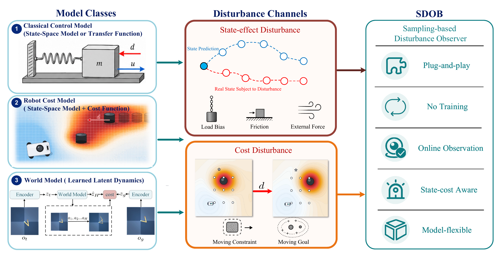
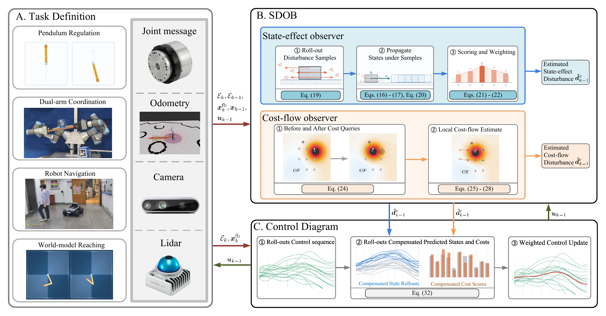
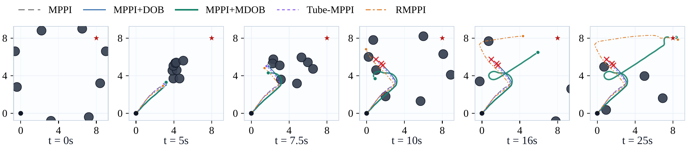
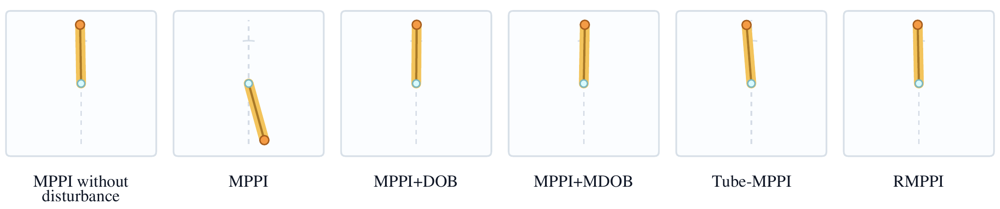
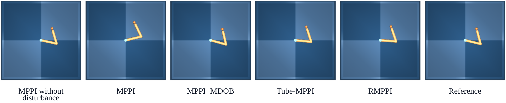

<h1 align="center">SDOB</h1>
<p align="center"><strong>Tackling Sim-to-Real Mismatch Through Sampling-Based Disturbance Observers: From Analytical Models to Learned World Models</strong></p>
<p align="center">通过基于采样的扰动观测器应对世界模型中的 Sim-to-Real 失配</p>

<p align="center">
  <a href="https://sampling-based-dob.github.io/">项目主页</a> ·
  <a href="https://sampling-based-dob.github.io/static/papers/sdob-paper.pdf">论文</a> ·
  <a href="https://youtu.be/ovb4moAlaC8">演示视频</a> ·
  <a href="README.md">English</a> ·
  <a href="LICENSE">MIT 许可证</a>
</p>
<p align="center"><code>Python 3.10–3.11</code> &nbsp; <code>PyTorch</code> &nbsp; <code>三个仿真示例</code></p>

<p align="center">
  <a href="docs/images/overview.png"></a>
</p>
<p align="center"><sub>在状态预测与代价查询接口上，利用反馈估计并补偿任务相关失配。</sub></p>

SDOB 根据相邻时刻的反馈评估扰动候选，将估计结果用于后续状态预测和代价计算。
在所需接口可用的条件下，方法通过模型前向计算与代价查询实现补偿，无需解析模型求逆或重新训练模型。

本工程提供可复用的 MPPI 与扰动观测器，首批开源包含 **三个独立仿真示例**：

| 示例 | 预测模型 | 补偿对象 | 运行入口 |
| :--- | :--- | :--- | :--- |
| [小车导航](#navigation) | 差速小车动力学与局部障碍物代价 | 状态效应与局部代价场运动 | `sdob-navigation` |
| [倒立摆](#pendulum) | 力矩受限倒立摆动力学 | 匹配力矩扰动 | `sdob-pendulum` |
| [LeWM Reacher](#reacher) | 冻结的图像世界模型 | 等效动作偏置 | `sdob-reacher` |

<p align="center">
  <a href="#quick-start">快速开始</a> ·
  <a href="#navigation">小车导航</a> ·
  <a href="#pendulum">倒立摆</a> ·
  <a href="#reacher">Reacher</a> ·
  <a href="#evaluation">评价说明</a> ·
  <a href="#development">开发与验证</a>
</p>

<details>
<summary><strong>方法流程：SDOB 如何接入控制回路？</strong></summary>

<p align="center">
  <a href="docs/images/control-flow.png"></a>
</p>

1. **观测**：比较已执行动作对应的预测结果与新获得的反馈。
2. **估计**：通过前向计算评价扰动候选，按采样权重形成估计。
3. **补偿**：将估计注入后续状态预测和代价查询，再更新控制序列。

图中展示论文的方法框架；本次代码发布范围为上表中的三个仿真示例。
图片来源记录在 [docs/images/README.md](docs/images/README.md)。

</details>

<a id="quick-start"></a>

## 快速开始

推荐使用 **Python 3.10**。在工程根目录执行：

```bash
python3.10 -m venv .venv
source .venv/bin/activate
python -m pip install --upgrade pip
python -m pip install -e '.[dev]'
sdob-check
```

小车和倒立摆均可直接使用 CPU 运行：

```bash
sdob-navigation
sdob-pendulum
```

使用 GPU 时，先按 [PyTorch 官方说明](https://pytorch.org/get-started/locally/)
安装匹配版本，再通过 `--device cuda:0` 选择设备。Reacher 需要[额外安装步骤](#reacher)。

<details>
<summary><strong>CPU 短程检查</strong>：先确认安装和输出流程</summary>

```bash
sdob-navigation --device cpu --steps 8 --horizon 5 --num-samples 32 --skip-gif
sdob-pendulum --device cpu --steps 8 --horizon 5 --num-samples 32 --skip-gif
```

短程运行用于检查执行链路和结果生成，不用于评价收敛性能。

</details>

<a id="navigation"></a>

## 01 · 小车移动障碍物导航

**状态效应与代价联合补偿。** 差速小车在八个移动障碍物之间导航，执行时受到隐藏的常值输入偏置。
SDOB 利用实际状态反馈和局部代价查询估计补偿，控制器不读取障碍物速度或未来轨迹。

[](docs/images/navigation.png)

*论文中的代表性导航过程。原图标注的“MPPI+MDOB”对应当前工程中的 MPPI+SDOB。*

```bash
sdob-navigation
```

| 配置 | 输出目录 | 生成内容 |
| :--- | :--- | :--- |
| [compare_8obs.yaml](sdob/examples/navigation/configs/compare_8obs.yaml) | `outputs/navigation/compare/8obs/` | 汇总 CSV、轨迹 CSV、PNG、可选 GIF |

对比控制器：**MPPI · MPPI+DOB · MPPI+SDOB · Tube-MPPI · RMPPI**。

<a id="pendulum"></a>

## 02 · 倒立摆扰动补偿

**匹配力矩扰动估计。** 观测器根据反馈与预测之间的误差估计力矩扰动，
将估计结果注入后续倒立摆状态预测。

[](docs/images/pendulum.png)

*论文展示正弦力矩扰动下的代表性状态。“MPPI+MDOB”为 MPPI+SDOB 的旧名称；
默认示例沿用常值扰动配置，可通过下面的命令切换为正弦扰动。*

```bash
# 默认：常值力矩偏置
sdob-pendulum

# 正弦力矩偏置：d(t) = 1.2 sin(1.2t) N m
sdob-pendulum --disturbance sinusoidal_bias --disturbance-value 1.2
```

| 配置 | 输出目录 | 生成内容 |
| :--- | :--- | :--- |
| [default.yaml](sdob/examples/pendulum/configs/default.yaml) | `outputs/pendulum/direct_compare/` | 汇总 CSV、轨迹 CSV、PNG、可选 GIF |

除与小车示例相同的五类控制器外，还提供无扰动 MPPI 作为参考。

<a id="reacher"></a>

## 03 · 冻结 LeWM 的 Reacher 补偿

**潜空间反馈补偿。** LeWorldModel 从图像预测未来状态，实际执行动作中加入隐藏偏置 `[0.30, -0.20]`。
SDOB 根据潜空间末端预测误差估计等效动作偏置。示例使用真实的 `swm/ReacherDMControl-v0`
环境与渲染得到的目标图像，不需要训练数据集。

[](docs/images/reacher.png)

*论文中的代表性最终观测。代码中的“WorldModel+SDOB”在原图中标为“MPPI+MDOB”。*

在工程根目录执行：

```bash
python -m pip install -e '.[reacher]'
python scripts/setup_reacher.py
sdob-download-reacher
MUJOCO_GL=egl sdob-reacher --device cuda:0
```

| 配置 | 输出目录 | 生成内容 |
| :--- | :--- | :--- |
| [reacher.yaml](sdob/examples/reacher/configs/reacher.yaml) | `outputs/reacher/reacher_lewm/` | 汇总、轨迹、观测器诊断 CSV，可选 MP4 与 PNG |

五组对比为：**无扰动 MPPI · 受扰动 MPPI · MPPI+SDOB · Tube-MPPI · RMPPI**。
关节坐标用于设置初始状态、目标和计算评价指标；默认扰动估计器使用图像与潜空间反馈。
运行失败时，程序会报错退出。

<details>
<summary><strong>模型下载、无显示器渲染与 GPU 短程检查</strong></summary>

安装脚本下载固定公开版本的 LeWM 和 stable-worldmodel，并应用单独记录的兼容补丁。
已有目录会保留；遇到不匹配的版本时脚本会报错。来源见[第三方版本说明](third_party/README.md)。
若上游代码位于其他目录，设置 `SDOB_LEWM_ROOT` 和 `SDOB_SWM_ROOT`。

模型来自[官方 Hugging Face 镜像](https://huggingface.co/quentinll/lewm-reacher)，
转换后默认写入 `~/.stable_worldmodel/reacher/lewm_object.ckpt`。
可以用 `STABLEWM_HOME` 更改缓存位置。已有模型镜像文件时：

```bash
sdob-download-reacher --source /path/to/reacher-mirror
```

`MUJOCO_GL=egl` 适用于已配置 EGL 驱动的 Linux 无显示器环境；有桌面环境时可省略。
支持 `--device cpu`，但完整 Reacher 配置计算量较大，建议使用 GPU。

```bash
# 五组控制器的短程运行检查
MUJOCO_GL=egl sdob-reacher --device cuda:0 --steps 10 --num-samples 8 --cem-steps 1 --skip-media
```

模型权重和上游工程单独下载，不打包进本项目源码。

</details>

<a id="evaluation"></a>

## 评价说明

以上图片来自论文。这里提供的命令是 **单个 seed 的演示**，本身不等同于论文的多次试验统计。

论文的 Reacher 结果基于 **20 个预先筛选的可解任务**：无扰动 MPPI 最后 20 步平均关节误差
不超过 0.025 rad；正式成功阈值为尾部平均误差小于 0.05 rad。
默认演示 seed 不等同于论文筛选集合。[reacher_protocol.py](sdob/examples/reacher/reacher_protocol.py)
保留了评价规则及独立随机数流的定义。

Tube-MPPI 与 RMPPI 为基准规模实现，这些示例不作形式化鲁棒性保证。
本次发布已完成的运行与回归检查见 [VALIDATION.md](VALIDATION.md)。

<a id="development"></a>

## 开发与验证

```bash
python -m pytest -q
python -m build
```

<details>
<summary><strong>目录结构与输出约定</strong></summary>

```text
sdob/
  controller/              # 可复用 MPPI 控制器
  observer/                # 状态效应与代价扰动观测器
  workspace/               # 实验生命周期
  examples/
    navigation/            # 小车移动障碍物导航
    pendulum/              # 受力矩扰动的倒立摆
    reacher/               # 冻结 LeWM 的 Reacher 补偿
docs/images/               # README 使用的论文图片
scripts/setup_reacher.py   # 下载固定版本的可选上游代码
third_party/patches/       # 显式记录的兼容补丁
tests/                    # 核心 API 与 Reacher 协议检查
```

默认 YAML 配置包含在安装包中，安装后的命令可以在工程目录之外运行。
输出路径相对于当前工作目录；使用 `--output-dir` 更改目录、`--help` 查看参数。
源码不依赖原工作区软链接或机器专属路径。

</details>

## 许可证与致谢

SDOB 代码采用 [MIT 许可证](LICENSE)。LeWM、stable-worldmodel 和预训练权重
保留各自的上游条款与署名。版本、补丁、模型来源与 LeWM 引用信息见
[THIRD_PARTY_NOTICES.md](THIRD_PARTY_NOTICES.md)。
